<!--
  ATLAS OF DESIRED STATE · VOL. 01
  Every plate on this page is an animated SVG drawn in code — see tools/README.md.
  Light and dark variants are swapped with <picture>; PL. 06 is regenerated weekly by GitHub Actions.
-->

<picture>
  <source media="(prefers-color-scheme: dark)" srcset="assets/plates/hero-dark.svg">
  <a href="https://github.com/Anup-Narkhede"></a>
</picture>

 

I’m **Anup Narkhede**, a Cloud DevOps Engineer. I build and automate cloud infrastructure with **AWS, Kubernetes, Terraform and Python**, and I’m currently pursuing an **M.Tech in Cloud Computing at BITS Pilani**.

My rule of thumb: anything done twice should be *declared once and reconciled forever*, which means pipelines instead of runbooks and controllers instead of reminders. The loop I’m exploring next is **AI agents that operate infrastructure through MCP**, with a human holding the approve key.

This page is an atlas of that idea. Each plate is a hand-composed, animated SVG, drawn entirely in code.

<code>PL. 01</code>&nbsp;<a href="#the-delivery-line">The Delivery Line</a> &nbsp;·&nbsp; <code>PL. 02</code>&nbsp;<a href="#two-control-planes">Two Control Planes</a> &nbsp;·&nbsp; <code>PL. 03</code>&nbsp;<a href="#stratigraphy">Stratigraphy</a> &nbsp;·&nbsp; <code>PL. 04</code>&nbsp;<a href="#exhibits">Exhibits</a> &nbsp;·&nbsp; <code>PL. 05</code>&nbsp;<a href="#credentials">Credentials</a> &nbsp;·&nbsp; <code>PL. 06</code>&nbsp;<a href="#signal">Signal</a> &nbsp;·&nbsp; <code>PL. 07</code>&nbsp;<a href="#open-channel">Open Channel</a>

 

<picture>
  <source media="(prefers-color-scheme: dark)" srcset="assets/plates/delivery-dark.svg">
  
</picture>

**PL. 01 — The Delivery Line.** Every change rides the same line: commit, Jenkins build, Docker image, Amazon ECR, Argo CD sync, Kubernetes, then observability. Terraform joins at *run*, and whatever production learns loops back into the next commit.

 

<picture>
  <source media="(prefers-color-scheme: dark)" srcset="assets/plates/planes-dark.svg">
  
</picture>

**PL. 02 — Two Control Planes.** Kubernetes taught me to think in reconciliation loops (*fig. A*). *Fig. B* is where I’m taking that idea: agents that plan against a goal, wait for a human to approve, then act through MCP tools and verify what happened.

 

<picture>
  <source media="(prefers-color-scheme: dark)" srcset="assets/plates/strata-dark.svg">
  
</picture>

**PL. 03 — Stratigraphy of a Stack.** These are the tools I use, not a pile of badges. Each layer was laid down on the one beneath it, roughly in the order my public repositories show I learned them: Linux bedrock in 2021, and the newest deposit, agents and MCP, still settling.

 

<picture>
  <source media="(prefers-color-scheme: dark)" srcset="assets/plates/section-exhibits-dark.svg">
  
</picture>

Four public repositories, each drawn as the system it builds.

<picture>
  <source media="(prefers-color-scheme: dark)" srcset="assets/plates/exhibit-01-dark.svg">
  <a href="https://github.com/Anup-Narkhede/cloud-native-monitoring-app-code"></a>
</picture>

> **Problem**&ensp;Clusters changed by hand drift away from what’s in git. 
> **Engineering**&ensp;Application code and Kubernetes manifests live in separate repositories. A Jenkins pipeline builds the Flask + psutil app into a Docker image and pushes it to Amazon ECR, whose repository is created with Boto3. Argo CD watches the manifest repo and syncs the cluster, and Terraform defines the EC2 instance. 
> **Why it’s interesting**&ensp;The cluster pulls its own desired state, so the deployment history *is* the git history. 
> [`cloud-native-monitoring-app-code`](https://github.com/Anup-Narkhede/cloud-native-monitoring-app-code) · [`manifest-repo`](https://github.com/Anup-Narkhede/manifest-repo)

 

<picture>
  <source media="(prefers-color-scheme: dark)" srcset="assets/plates/exhibit-02-dark.svg">
  <a href="https://github.com/Anup-Narkhede/Pinger_App_K8S"></a>
</picture>

> **Problem**&ensp;Knowing whether a URL is up, and how fast it answers, all the time rather than only when someone checks. 
> **Engineering**&ensp;Three Node.js services: a frontend, a pinger that loops over URLs recording latency, response code and size, and a details service. Each is containerised and deployed to a local kind cluster with a control plane and three workers, and a build script loads the images straight into the cluster. 
> **Why it’s interesting**&ensp;Pinger v1 and v2 run side by side, the same shape as every canary rollout. 
> [`Pinger_App_K8S`](https://github.com/Anup-Narkhede/Pinger_App_K8S)

 

<picture>
  <source media="(prefers-color-scheme: dark)" srcset="assets/plates/exhibit-03-dark.svg">
  <a href="https://github.com/Anup-Narkhede/terraform-project-an"></a>
</picture>

> **Problem**&ensp;One giant Terraform file can’t be reviewed or reused, and unlocked state invites collisions. 
> **Engineering**&ensp;Each service has its own module. The Lambda module is built: an IAM execution role, source packaged with `archive_file` and redeployed on hash change, and environment configuration. The Python handler routes user-removal events to a Slack notifier, which is still a stub. API Gateway, EC2 and MemoryDB modules are scaffolded next to it, drawn as blueprints above. 
> **Why it’s interesting**&ensp;State is encrypted in S3 with Terraform’s native `use_lockfile`, so there’s no DynamoDB lock table to babysit. 
> [`terraform-project-an`](https://github.com/Anup-Narkhede/terraform-project-an)

 

<picture>
  <source media="(prefers-color-scheme: dark)" srcset="assets/plates/exhibit-04-dark.svg">
  <a href="https://github.com/Anup-Narkhede/Serverless-Web-Application"></a>
</picture>

> **Problem**&ensp;A full web app with no servers to patch, scale or keep awake. 
> **Engineering**&ensp;Static hosting on S3 behind CloudFront, sign-in with Cognito, and an API Gateway → Lambda backend that writes to DynamoDB, observed with CloudWatch. 
> **Why it’s interesting**&ensp;Six managed services compose one request path, and the IAM boundaries between them are the real design work. 
> [`Serverless-Web-Application`](https://github.com/Anup-Narkhede/Serverless-Web-Application)

Also in the archive: [Boto3 automation scripts](https://github.com/Anup-Narkhede/Boto3-Python-SDK) for IAM, S3, EC2 and SQS · [AWS CLI shell projects](https://github.com/Anup-Narkhede/AWS-Projects) for ALB, Auto Scaling and EC2 · [Linux ops scripts](https://github.com/Anup-Narkhede/LinuxWorld) · [Docker + ECR + CloudFormation](https://github.com/Anup-Narkhede/Docker-Project-Mongo-Node-AWS-ECR-) · [Terraform labs](https://github.com/Anup-Narkhede/Terraform)

 

<picture>
  <source media="(prefers-color-scheme: dark)" srcset="assets/plates/section-credentials-dark.svg">
  
</picture>

  <picture><source media="(prefers-color-scheme: dark)" srcset="assets/plates/seal-saa-dark.svg"></picture>
  <picture><source media="(prefers-color-scheme: dark)" srcset="assets/plates/seal-dva-dark.svg"><a href="https://www.credly.com/badges/f3fe5f9d-0427-4d52-8ffe-ceb9cf3baec3"></a></picture>
  <picture><source media="(prefers-color-scheme: dark)" srcset="assets/plates/seal-clf-dark.svg"><a href="https://www.credly.com/badges/7c20de9c-e554-49bb-b4cc-9921046c1198"></a></picture>
  <picture><source media="(prefers-color-scheme: dark)" srcset="assets/plates/seal-az900-dark.svg"><a href="https://www.credly.com/badges/f98694af-f545-40e4-950b-152a7faff3d4"></a></picture>

Each seal links to its Credly verification.

 

<picture>
  <source media="(prefers-color-scheme: dark)" srcset="assets/plates/signal-dark.svg">
  
</picture>

**PL. 06 — Signal.** The last twelve months of contributions, drawn as a seismograph. A GitHub Action regenerates this plate every week from the GraphQL contributions calendar, with no third-party stats service involved.

 

<picture>
  <source media="(prefers-color-scheme: dark)" srcset="assets/plates/finale-dark.svg">
  <a href="https://www.linkedin.com/in/anup-narkhede-3291211ab/"></a>
</picture>

  <a href="https://www.linkedin.com/in/anup-narkhede-3291211ab/"><b>LinkedIn</b></a> &nbsp;·&nbsp;
  <a href="https://anup-narkhede.github.io/Portfolio/"><b>Portfolio</b></a> &nbsp;·&nbsp;
  <a href="https://github.com/Anup-Narkhede?tab=repositories"><b>All repositories</b></a>

<i>Colophon</i> — set in Archivo Expanded, Instrument Serif and JetBrains Mono (SIL OFL), embedded as per-plate subsets. Plates are generated by <a href="tools/README.md"><code>tools/build.py</code></a>. No templates were harmed.

